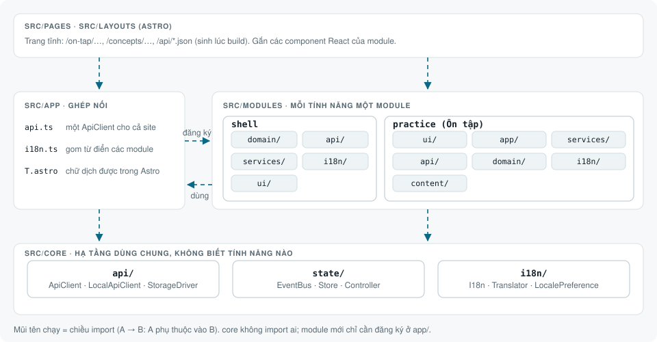

# Kiến trúc app · CloudLab

Tài liệu này dành cho người sửa code trong `aws-cloud/site/`. Nó trả lời ba câu hỏi:

- Code được chia thành những phần nào?
- Một thao tác của người dùng đi qua các phần đó ra sao?
- Muốn thêm tính năng hoặc chuyển dữ liệu lên server thì sửa ở đâu?

Các hình bên dưới là SVG có chuyển động. Chúng tự chạy trên GitHub và đổi màu theo chế độ sáng/tối của máy.

- [Tổng quan: core, modules, app](#tổng-quan-core-modules-app)
- [Nguyên tắc](#nguyên-tắc)
- [Các tầng trong một module](#các-tầng-trong-một-module)
- [Một lần bấm Kiểm tra](#một-lần-bấm-kiểm-tra)
- [API và lưu trữ](#api-và-lưu-trữ)
- [Ngôn ngữ VI / EN](#ngôn-ngữ-vi--en)
- [Giao diện sáng / tối](#giao-diện-sáng--tối)
- [Thêm một module mới](#thêm-một-module-mới)
- [Chuyển dữ liệu lên server](#chuyển-dữ-liệu-lên-server)
- [Sửa hình minh hoạ](#sửa-hình-minh-hoạ)
- [Deploy lên Vercel](#deploy-lên-vercel)

## Tổng quan: core, modules, app



| Thư mục | Vai trò | Được import từ đâu |
|---|---|---|
| `src/core/` | Hạ tầng dùng chung: API client, lưu trữ, event/store/controller, i18n, lựa chọn của người xem (`preferences/`), giao diện sáng/tối (`theme/`). Không biết có tính năng nào. | mọi nơi |
| `src/modules/<tên>/` | Một tính năng, tự chứa đủ các tầng. Hiện có `shell` (khung trang, cài đặt) và `practice` (Luyện đề). | `app/`, `pages/` |
| `src/app/` | Tầng ghép nối: tạo **một** `ApiClient` cho cả site (`api.ts`), gom từ điển của các module (`i18n.ts`), tạo `theme` (`theme.ts`). | module (lấy i18n, ApiClient), `pages/` |
| `src/pages/`, `src/layouts/` | Trang Astro tĩnh. Gắn component React của module, sinh `/api/*.json` lúc build. | không ai |

Phần lý thuyết cũ (`src/content/`, `src/components/`, `src/data/`) vẫn giữ cấu trúc cũ. Phần đó chưa có dữ liệu người dùng nào cần lưu.

## Nguyên tắc

1. **Mỗi tầng chỉ gọi tầng ngay dưới nó.**
   - UI chỉ phát event, không gọi service.
   - Service chỉ gọi `ApiClient`, không chạm vào IndexedDB.
2. **Mọi việc đọc và ghi dữ liệu đều đi qua API kiểu REST** (`api.get/post/put/patch`), kể cả khi dữ liệu đang nằm trong trình duyệt. Nhờ vậy, chuyển lên server chỉ phải đổi một chỗ.
3. **Hướng đối tượng, TypeScript strict.**
   - Mỗi điểm mở rộng là một lớp `abstract`: `ApiClient`, `StorageDriver`, `LocalResource`, `Store`, `Controller`, `ApiService`, `Preference`, `Choice`, `ExamSource`.
   - Phần cài đặt cụ thể là lớp con của các lớp đó.
4. **`core` không import gì từ `modules` hay `app`.** Một module không import module khác.
5. **Chữ hiển thị nằm trong từ điển của module** (`i18n/vi.ts`, `i18n/en.ts`), không viết thẳng trong component. Lỗi cũng là mã lỗi; UI mới dịch mã đó ra chữ.

## Các tầng trong một module

Ví dụ với `src/modules/practice/`:

| Tầng | Thư mục | Lớp chính | Làm gì |
|---|---|---|---|
| UI | `ui/` | `CatalogPage`, `ExamPage`, `QuestionCard`, `ResultPanel` | Đọc store bằng `useStore`, phát event bằng `dispatch`. Không có logic nghiệp vụ. |
| Xử lý event | `app/` | `PracticeApp`, `CatalogController`, `ExamController`, `CatalogStore`, `ExamStore` | Controller nhận event, gọi service, ghi kết quả vào store. |
| Gọi API | `services/` | `CatalogService`, `AttemptService` (kế thừa `ApiService`) | Biến một nhu cầu thành một lời gọi REST. |
| Route trong trình duyệt | `api/` | `AttemptResource` (kế thừa `LocalResource`) | "Server giả": trả lời `/attempts/**`, ghi vào `StorageDriver`. |
| Nghiệp vụ | `domain/` | `types.ts`, `Scoring` | Kiểu dữ liệu chung và quy tắc chấm điểm. |
| Chữ hiển thị | `i18n/` | `vi.ts`, `en.ts` | Từ điển của module. |
| Lúc build | `content/` | `PracticeCatalog`, `ExamSource` → `QuizHtmlSource`, `HtmlSanitizer` | Đọc file đề HTML, làm sạch HTML, sinh JSON. Chỉ chạy lúc build, không vào bundle trình duyệt. |

`PracticeApp` là nơi ghép các lớp của module: ApiClient → services → controllers. Mỗi trang chỉ có một bản `PracticeApp`.

## Một lần bấm Kiểm tra



1. `QuestionCard` gọi `dispatch({ type: "exam/submit" })`. Component không biết điều gì xảy ra sau đó.
2. `EventBus` chuyển event tới `ExamController.submit()`. Controller chấm đúng/sai bằng `Scoring.isCorrect`.
3. `AttemptService.answer()` gọi `api.put("/attempts/:id/answers/:questionId", { chosen, correct })`.
4. `CompositeApiClient` thấy đường dẫn `/attempts`, nên chuyển yêu cầu cho `LocalApiClient`.
5. `LocalApiClient` khớp route rồi gọi `AttemptResource`. Resource ghi lượt làm bài qua `StorageDriver`. Hiện tại driver là IndexedDB; nếu không dùng được thì chuyển sang localStorage, rồi đến bộ nhớ tạm.
6. `Attempt` mới được trả ngược lên. Controller gọi `ExamStore.saved(attempt)`.
7. Store báo cho các component đang theo dõi. `useStore` vẽ lại `QuestionCard` với kết quả đúng/sai và lời giải.

Lưu thất bại thì store nhận mã lỗi `saveAnswer`. UI dịch mã đó sang ngôn ngữ đang chọn.

## API và lưu trữ



`src/app/api.ts` tạo một `CompositeApiClient`. Lớp này nhìn đường dẫn để chọn nơi trả lời:

| Method | Đường dẫn | Ai trả lời hôm nay | Trả về |
|---|---|---|---|
| GET | `/certifications` | `StaticApiClient` → `/api/certifications.json` | danh sách chứng chỉ |
| GET | `/certifications/:cert` | `StaticApiClient` | chứng chỉ + danh sách đề |
| GET | `/certifications/:cert/exams/:exam` | `StaticApiClient` | đề kèm câu hỏi, đáp án, lời giải |
| GET | `/attempts?certId=&examId=` | `LocalApiClient` → `AttemptResource` | các lượt làm, mới nhất trước |
| GET | `/attempts/latest?certId=&examId=` | `LocalApiClient` → `AttemptResource` | lượt mới nhất (404 nếu chưa có) |
| POST | `/attempts` | `LocalApiClient` → `AttemptResource` | lượt làm mới |
| PUT | `/attempts/:id/answers/:questionId` | `LocalApiClient` → `AttemptResource` | lượt làm sau khi lưu câu trả lời |
| GET | `/preferences` | `LocalApiClient` → `PreferenceResource` | cài đặt của người xem (`locale`, `theme`) |
| PATCH | `/preferences` | `LocalApiClient` → `PreferenceResource` | cài đặt sau khi đổi |

Các lớp dùng chung nằm trong `src/core/api/`:

- `ApiClient` (abstract) có các phương thức `get / post / put / patch / delete`, tất cả cùng đi qua `request()`.
  - `HttpApiClient`: gọi `fetch()` tới server. Có `headers()` để gắn token khi có đăng nhập.
  - `StaticApiClient`: đổi `/x/y` thành `/api/x/y.json`, chỉ cho phép GET.
  - `LocalApiClient`: bộ định tuyến chạy trong trình duyệt, chuyển yêu cầu tới các `LocalResource`.
  - `CompositeApiClient`: chọn client theo đường dẫn.
- `StorageDriver` (abstract) có các thao tác `get / put / delete / list`, nhóm dữ liệu theo collection. Có ba bản cài đặt: `IndexedDbDriver`, `LocalStorageDriver`, `MemoryDriver`.

## Ngôn ngữ VI / EN



**Các thành phần:**
- `I18n` (`core/i18n`) giữ từ điển của mọi ngôn ngữ và ngôn ngữ đang chọn. Lớp này báo cho React (`useI18n`) và cho `DomTranslator` (chữ trong trang Astro) mỗi khi ngôn ngữ đổi.
- Lựa chọn ngôn ngữ được lưu qua API: `PATCH /preferences` (`ApiPreference` của module `shell`, field `locale`). Ngoài ra có một bản sao trong localStorage để script trong `<head>` đọc trước khi trang hiện ra.
- Mỗi module có từ điển riêng. `app/i18n.ts` gom các từ điển đó lại theo tên module (`shell.*`, `practice.*`).
- `en.ts` có kiểu `Messages<typeof vi>`, nên thiếu hoặc thừa key sẽ không qua được `astro check`.

**Cách dùng:**
- Trong React: `useI18n().t("practice.exam.check")`, hoặc `useT()` của module với key ngắn (`t("exam.check")`).
- Trong Astro: `<T k="practice.catalog.title" />`.

**Quy ước câu chữ:**
- Tiếng Anh dùng đúng thuật ngữ của AWS exam guide và của đề, ví dụ "Practice Test", "Select TWO", "Correct option", "minimum passing score".
- Cả hai ngôn ngữ dùng từ đơn giản nhất có thể, chỉ giữ thuật ngữ chuyên ngành.

## Giao diện sáng / tối

Nút mặt trời / mặt trăng ở cuối thanh menu. Mặc định là **tối**, vì đa số người đọc là developer.

**Cách hoạt động:**
- `ThemeManager` (`core/theme`) giữ giao diện hiện tại và ghi `data-theme="dark|light"` lên `<html>`.
- Lựa chọn được lưu giống ngôn ngữ: `ApiPreference` với field `theme` → `PATCH /preferences`, kèm bản sao trong localStorage.
- `ThemeManager` và `I18n` cùng kế thừa `Choice<T>` (`core/preferences`). Lớp này giữ một giá trị, báo thay đổi và lưu qua một `Preference<T>`.

**Không nháy màu khi mở trang:**
- Script inline trong `<head>` đọc localStorage và đặt `data-theme` trước khi trang được vẽ, trước cả mọi bundle JavaScript.

**Đổi chế độ không làm vỡ giao diện:**
- Mọi màu trong CSS là token (`--bg`, `--surface`, `--ink`, `--muted`, `--line`, `--accent`, `--ok`, `--bad`, `--edge`, `--on-accent`, `--shadow`). Các token được khai báo lại trong `:root[data-theme="dark"]`.
- Component không tự kiểm tra đang ở chế độ nào và không dùng mã màu cố định.
- Khi cần chữ trên nền accent, dùng `--on-accent` (trắng ở chế độ sáng, gần đen ở chế độ tối).
- Mọi cặp chữ/nền ở cả hai chế độ đạt độ tương phản ≥ 4.5:1.
- Lúc bấm đổi, class `theme-switching` bật hiệu ứng chuyển màu 0,25 giây. Lúc tải trang thì không có hiệu ứng này.
- Chỉ phần nào không dùng được CSS (ví dụ canvas) mới cần `useTheme()` từ `app/theme.ts`.

## Thêm một module mới

Ví dụ tính năng "Tình huống" (`scenarios`):

1. **Tạo thư mục** `src/modules/scenarios/` với các tầng cần dùng: `domain/`, `services/`, `app/`, `ui/`, `i18n/`, và `api/` nếu có dữ liệu cần lưu.
2. **Tạo từ điển.** Viết `i18n/vi.ts` trước (đây là bản nguồn), sau đó viết `i18n/en.ts` với kiểu `Messages<typeof vi>`. Cuối cùng gọi `defineMessages(vi, { en })` trong `i18n/index.ts`.
3. **Đăng ký từ điển** trong `src/app/i18n.ts`: `combineMessages({ shell, practice, scenarios })`.
4. **Nếu module lưu dữ liệu:**
   - Viết các lớp con của `LocalResource` trong `api/`.
   - Export `scenariosLocalPaths` và `scenariosLocalResources(storage)`.
   - Đăng ký hai thứ đó trong `src/app/api.ts`.
5. **Tạo trang** trong `src/pages/` và gắn component của module bằng `client:only="react"`.

## Chuyển dữ liệu lên server

1. Viết server REST có đúng các đường dẫn trong bảng ở mục [API và lưu trữ](#api-và-lưu-trữ). Lớp `LocalResource` của từng module chính là bản mẫu cho controller tương ứng phía server.
2. Trong `src/app/api.ts`, trả về `new HttpApiClient({ baseUrl, headers })`. Trong giai đoạn chuyển dần, có thể dùng `CompositeApiClient` để chỉ một số đường dẫn đi ra server.
3. Service, controller, store và UI giữ nguyên. Dữ liệu cũ trong IndexedDB có thể đọc qua `LocalApiClient` một lần rồi gửi lên server.

## Sửa hình minh hoạ

Bốn hình trong `docs/diagrams/` được sinh bằng script, đừng sửa SVG bằng tay:

```bash
cd aws-cloud/site
node docs/diagrams/generate.mjs
```

- **Công nghệ:** hình dùng SVG + SMIL (`animateMotion`, `animate`). Không có JavaScript, nên chạy được trong README của GitHub.
- **Thời gian:** mọi chuyển động dùng chung một vòng 12 giây. Hàm `arrivals()` tính thời điểm chấm tròn tới từng hộp, để phần sáng lên ở danh sách bước khớp với chuyển động.
- **Màu:** lấy theo bảng màu của site. Có khối `@media (prefers-color-scheme: dark)` cho chế độ tối.
- **Giảm chuyển động:** máy bật `prefers-reduced-motion` thì đường nét đứt sẽ dừng chạy.

## Chạy và kiểm tra

```bash
cd aws-cloud/site
npm ci
npm run dev       # http://localhost:4321/practice/
npm run build     # astro check (kiểu TypeScript, key i18n) + build ra dist/
```

## Deploy lên Vercel

Cấu hình build nằm trong repo:

- `vercel.json`: framework Astro, `npm ci`, `npm run build` (kiểm tra kiểu rồi build), xuất ra `dist`, URL có dấu `/` ở cuối.
- `package.json` → `engines.node: 22.x`.
- `middleware.ts`: khoá cả site bằng mật khẩu (Vercel Routing Middleware). Gói Hobby của Vercel không khoá được trang production, nên phần này cần thiết vì trang Luyện đề chứa nội dung đề có bản quyền.

**Lần đầu:**

1. Vào vercel.com → **Add New… → Project**, rồi import repo `thaotm99/aws` từ GitHub.
2. **Root Directory**: chọn `aws-cloud/site`. Giữ bật tuỳ chọn cho phép dùng file nằm ngoài Root Directory, vì lúc build site cần đọc `solution-architect-aws/` để sinh dữ liệu đề.
3. **Environment Variables**: thêm `SITE_USER` và `SITE_PASSWORD` (chọn cả Production và Preview). Xem bảng biến môi trường bên dưới.
4. Bấm **Deploy**. Từ đó, mỗi lần push lên nhánh production, Vercel tự build lại. Mỗi PR có link preview riêng.

**Biến môi trường của `middleware.ts`:**

| Biến | Ý nghĩa |
|---|---|
| `SITE_USER` | Tên đăng nhập (Basic Auth). |
| `SITE_PASSWORD` | Mật khẩu. Được giải mã theo UTF-8, nên dùng được ký tự tiếng Việt có dấu. |
| `SITE_PUBLIC` | Đặt `1` để chủ động mở site public khi không đặt `SITE_USER`/`SITE_PASSWORD`. |
| `SITE_PROTECT` | Chỉ khoá một số đường dẫn, phân tách bằng dấu phẩy, ví dụ `**/practice/**, **/quiz/**`. Để trống: khoá cả site. `/api/**` luôn bị khoá kèm vì trang Luyện đề tải dữ liệu đề từ đó. |
| `VERCEL_ENV` | Do Vercel tự đặt (`production`, `preview`, `development`). Không cần khai báo. |

Middleware đóng mặc định (fail closed):

- Chỉ đặt một trong hai biến `SITE_USER` / `SITE_PASSWORD`: mọi request trả về 500 "Site auth misconfigured".
- Không đặt cả hai trên Production (`VERCEL_ENV=production`): cũng trả về 500, trừ khi có `SITE_PUBLIC=1`.
- Không đặt cả hai trên Preview/Development, hoặc có `SITE_PUBLIC=1`: site public.
- Đặt đủ cả hai: hỏi tài khoản và mật khẩu (401 nếu sai). Nếu có `SITE_PROTECT` thì chỉ hỏi ở các đường dẫn khớp, còn lại mở.

Cú pháp `SITE_PROTECT`: `*` khớp trong một đoạn đường dẫn, `**` khớp qua nhiều đoạn. `/practice/**` khoá
`/practice/` và mọi trang con; `**/quiz/**` khoá `/concepts/<bài>/quiz/`. So khớp không phân biệt hoa thường
và giải mã `%xx` trước, nên không lách được bằng `/PRACTICE/` hay `/%70ractice/`.

Trình duyệt sẽ hỏi tài khoản và mật khẩu ở lần mở đầu tiên, và nhớ cho các lần sau. Middleware chỉ chạy trên Vercel; `npm run dev` và `npm run preview` ở máy không bị hỏi mật khẩu.
